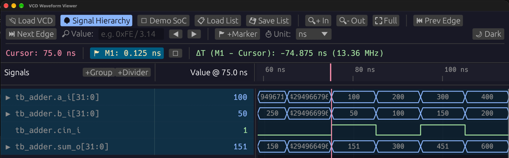

# VCD Viewer

A fast, cross-platform, modern Value Change Dump (VCD) waveform viewer written in Rust using [`egui`](https://github.com/emilk/egui) / [`eframe`](https://github.com/emilk/egui/tree/master/crates/eframe). Supports native desktop (macOS, Linux, Windows) and WebAssembly (WASM) in the browser.



---

## Table of Contents

- [Features](#features)
  - [Waveform Display & Navigation](#waveform-display--navigation)
  - [Signal Hierarchy Browser](#signal-hierarchy-browser)
  - [Signal Pane & Multi-Selection](#signal-pane--multi-selection)
  - [Rich Formats & IEEE 754 Floating-Point](#rich-formats--ieee-754-floating-point)
  - [High Performance & IEEE 1364 Compliance](#high-performance--ieee-1364-compliance)
  - [Layout Persistence](#layout-persistence)
  - [Themes & Cross-Platform Support](#themes--cross-platform-support)
- [Quick Start](#quick-start)
  - [Prerequisites](#prerequisites)
  - [Running the Native Desktop App](#running-the-native-desktop-app)
  - [Running the Web (WASM) Version](#running-the-web-wasm-version)
  - [Testing with the Built-in Demo SoC](#testing-with-the-built-in-demo-soc)
- [Keyboard & Mouse Shortcuts](#keyboard--mouse-shortcuts)
  - [Waveform & Navigation (Synopsys nWave Compatible)](#waveform--navigation-synopsys-nwave-compatible)
  - [Signal Pane Shortcuts](#signal-pane-shortcuts)
- [SystemVerilog Example (Verilator)](#systemverilog-example-verilator)
- [Project Architecture](#project-architecture)
- [License](#license)

---

## Features

### Waveform Display & Navigation
- **Synopsys nWave Keyboard Navigation**: Use industry-standard hotkeys:
  - `Shift+Z` / `Z`: Zoom In
  - `z`: Zoom Out
  - `f`: Zoom to Full waveform range
  - `g`: Reveal / Toggle Signal Hierarchy window
- **Drag-to-Zoom**: Click and drag horizontally on the waveform canvas to zoom directly into any time window.
- **Dual Cursors & Delta Measurements**:
  - Primary Cursor (left click): shows exact timestamp and signal values in the Value column.
  - Baseline Marker (right click / toolbar button): computes delta time ($\Delta t$) and instantaneous frequency ($1 / \Delta t$).
- **Transition Edge Searching**: Quickly jump the primary cursor forward or backward to the next value transition on the active signal.
- **Configurable Time Units**: Supports `Auto`, `fs`, `ps`, `ns`, `µs`, `ms`, and `s`.

### Signal Hierarchy Browser
- **Scope Tree Navigation**: Browse the complete hierarchy tree (`modules`, `tasks`, `functions`, `begin` blocks).
- **Search & Filter**: Real-time signal name filtering within scopes.
- **Batch Signal Selection**: Checkbox toggling and multi-selection with `Shift` contiguous range selection to easily add multiple signals to the waveform.
- **Dedicated Toolbar Access**: Dedicated `🌳 Signal Hierarchy` button in the top toolbar.

### Signal Pane & Multi-Selection
- **Comprehensive Multi-Selection**:
  - `Ctrl+Click` / `Cmd+Click`: Toggle individual signals into or out of selection.
  - `Shift+Click` / `Shift+Up` / `Shift+Down`: Select contiguous ranges of signals.
  - `Cmd+A` / `Ctrl+A`: Select all signals.
- **Batch Editing & Context Menu**: Right-click on any selected signal to perform batch actions on all selected signals simultaneously:
  - Change Radix & Floating-Point representation
  - Change Render Style (Digital, Analog Step, Analog Interpolated)
  - Assign Trace Color
  - Expand / Collapse individual bus bits
  - Move to Group / Grouping
- **Clipboard & Reordering**:
  - `Cmd+C` / `Ctrl+C`: Copy signals.
  - `Cmd+X` / `Ctrl+X`: Cut selected signals.
  - `Cmd+V` / `Ctrl+V`: Paste signals at the selected anchor position.
  - `Del` / `Backspace`: Delete selected signals.

### Rich Formats & IEEE 754 Floating-Point
- **Standard Radixes**: Binary (`Bin`), Octal (`Oct`), Hexadecimal (`Hex`), Unsigned Decimal (`Dec`), Signed Decimal (`Signed Dec`), and ASCII string decoding.
- **IEEE 754 Floating-Point Decoding**: Built-in support for hardware floating-point buses:
  - `FP16` (Half Precision, 16-bit)
  - `BF16` (Brain Floating Point, 16-bit)
  - `FP32` (Single Precision, 32-bit)
  - `FP64` (Double Precision, 64-bit)
  - Clean formatting for `NaN`, `+Inf`, `-Inf`, and subnormals, with strict multi-bit `X` / `Z` mask handling.

### High Performance & IEEE 1364 Compliance
- **Chunked Streaming Parser**: Memory-efficient streaming loader capable of indexing and displaying large multi-gigabyte VCD files smoothly.
- **IEEE 1364 Vector Extension Rules**: Accurately sign-extends and zero-extends vectors according to standard Verilog VCD rules (`0`/`1` zero-extended; `x`/`z` bit-replicated).
- **Signal Alias Resolution**: Handles identical VCD identifiers mapped across multiple scopes without data loss or transition corruption.

### Layout Persistence
- **Save / Load Signal Lists**: Save customized signal arrangements, bus groupings, radix preferences, and trace colors to `.vcdview.json` files and reload them across sessions.

### Themes & Cross-Platform Support
- **Themes**: Switch between Dark theme (default) and Light theme.
- **Cross-Platform**: Runs natively on macOS, Linux, and Windows, or in modern web browsers via WebAssembly.

---

## Quick Start

### Prerequisites

- **Rust Toolchain**: Install Rust and Cargo (1.75+ recommended):
  ```bash
  curl --proto '=https' --tlsv1.2 -sSf https://sh.rustup.rs | sh
  ```

### Running the Native Desktop App

1. **Clone the repository:**
   ```bash
   git clone https://github.com/your-username/vcd-viewer.git
   cd vcd-viewer
   ```

2. **Run natively:**
   ```bash
   cargo run --release
   ```

3. **Open a VCD file directly from CLI:**
   ```bash
   cargo run --release -- path/to/dump.vcd
   ```
   Or click **📂 Open VCD** inside the application to select a file.

### Running the Web (WASM) Version

The web version runs entirely in the client's browser without requiring a backend server.

1. **Add the WebAssembly target:**
   ```bash
   rustup target add wasm32-unknown-unknown
   ```

2. **Install Trunk** (the WASM web application bundler):
     ```bash
   cargo install trunk --locked
     ```

3. **Build and serve:**
   ```bash
   trunk serve --release
   ```

4. Open your browser at **`http://127.0.0.1:8080`**.

To produce a production bundle ready for static web hosting:
```bash
trunk build --release
```
The output files will be located in the `dist/` directory.

### Testing with the Built-in Demo SoC

Click the **🧪 Demo SoC** button in the top toolbar to instantly generate and load a realistic multicore SoC simulation waveform with clocks, memory buses, FP32 pipelines, and interrupt lines.

---

## Keyboard & Mouse Shortcuts

### Waveform & Navigation (Synopsys nWave Compatible)

| Shortcut | Action | Description |
| :--- | :--- | :--- |
| `Shift + Z` / `Z` | **Zoom In** | Zoom in centered on the primary cursor |
| `z` | **Zoom Out** | Zoom out centered on the primary cursor |
| `f` | **Zoom Full** | Zoom to fit the entire time range |
| `g` | **Hierarchy Window** | Open / reveal the Signal Hierarchy modal |
| **Left Click** | **Set Cursor** | Places the primary cursor and updates signal values |
| **Right Click** | **Set Marker** | Places the baseline marker for delta measurement ($\Delta t$) |
| **Horizontal Drag** | **Range Zoom** | Click and drag across any region to zoom into that window |
| **Mouse Wheel** | **Scroll / Zoom** | Scroll time axis horizontally; `Ctrl + Wheel` zooms |

### Signal Pane Shortcuts

| Shortcut | Action | Description |
| :--- | :--- | :--- |
| `Cmd + A` / `Ctrl + A` | **Select All** | Select all visible signals in the list |
| `Cmd + Click` / `Ctrl + Click` | **Multi-Select** | Toggle signal inclusion in selection |
| `Shift + Click` | **Range Select** | Contiguously select from anchor to clicked signal |
| `Shift + Up` / `Down` | **Range Extend** | Extend selection contiguous range with arrow keys |
| `Cmd + X` / `Ctrl + X` | **Cut** | Cut selected signals to internal clipboard |
| `Cmd + C` / `Ctrl + C` | **Copy** | Copy selected signals to internal clipboard |
| `Cmd + V` / `Ctrl + V` | **Paste** | Paste copied signals after current anchor |
| `Delete` / `Backspace` | **Delete** | Remove selected signals from waveform view |
| **Right Click** | **Context Menu** | Open batch format / style / radix operations |

---

## SystemVerilog Example (Verilator)

An example SystemVerilog adder with testbench and VCD dump generator is included under [`example/`](example/):

```bash
cd example

# Compile and simulate using Verilator to dump adder.vcd
make run

# Launch VCD Viewer directly on the generated waveform
make view
```

Files included in the example:
- `example/adder.sv`: Parameterized multi-bit adder module.
- `example/tb_adder.sv`: SystemVerilog testbench dumping `adder.vcd`.
- `example/adder_signals.vcdview.json`: Preconfigured signal list layout.
- `example/Makefile`: Build and simulation automation.

---

## Project Architecture

```
vcd-viewer/
├── src/
│   ├── main.rs              # Native entry point
│   ├── lib.rs               # Library & WASM entry point (wasm-bindgen)
│   ├── byte_source.rs       # Abstract memory / chunked file byte streaming
│   ├── vcd_header.rs        # VCD header, timespec, and scope tree parser
│   ├── vcd_loader.rs        # VCD streaming transition parser & IEEE 1364 rules
│   ├── waveform_db.rs       # Transition storage, binary search & LOD downsampling
│   ├── format.rs            # Multi-radix and IEEE 754 float decoders
│   ├── project.rs           # Project session state & .vcdview.json serializer
│   └── ui/
│       ├── mod.rs           # Main egui application coordinator & input routing
│       ├── toolbar.rs       # Top toolbar with load, zoom, and theme controls
│       ├── signal_list.rs   # Multi-select signal pane, value column & context menu
│       ├── waveform_canvas.rs # High-DPI waveform rendering, grid, cursors & LOD
│       └── hierarchy_modal.rs # Scope tree browser with search & Shift-range selection
├── example/                 # SystemVerilog Verilator simulation example
├── docs/images/             # Documentation screenshots
├── index.html               # WebAssembly HTML shell
├── Trunk.toml               # Trunk build configuration
└── Cargo.toml               # Rust dependencies & target configuration
```

---

## License

Dual-licensed under either:
- **MIT License** ([LICENSE-MIT](LICENSE-MIT) or <http://opensource.org/licenses/MIT>)
- **Apache License, Version 2.0** ([LICENSE-APACHE](LICENSE-APACHE) or <http://www.apache.org/licenses/LICENSE-2.0>)

at your option.
